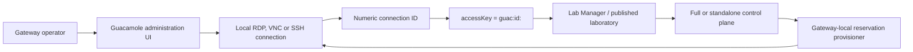

# Configure a Guacamole laboratory connection

Use this guide to create the **local** Guacamole connection for a physical
laboratory. The connection belongs to the Gateway named by the lab's
`accessURI`; it is not shared automatically with a Full control plane or other
Lite Gateways.

For private-network requirements and the Lab Station lifecycle, read
[Laboratory connectivity](../workflows/laboratory-connectivity.md) and
[Gateway and Lab Station operations](../workflows/gateway-lab-station-operations.md)
first.

## Result and ownership

When a connection is saved, Guacamole assigns a numeric connection ID. Publish
the physical laboratory with:

```text
accessKey = guac:id:<connection_id>
accessURI = https://<gateway-that-owns-this-catalog>
```

In a Full + N Lite or standalone-backend + N Lite deployment, the control plane
uses `accessURI` to choose an explicit protected provisioner route. It must
never fall back to a different Gateway's Guacamole catalog.



## Before you begin

- Confirm that `guacamole` and `guacd` are running: `docker compose ps`.
- Verify that **guacd**, not the user's browser, can reach the laboratory over
  the private RDP, VNC, or SSH network path.
- Create a dedicated non-administrator Windows or device account for lab
  sessions. Do not reuse the Gateway or Guacamole administrator identity.
- For a Windows Lab Station, ensure the required remote service is enabled and
  its firewall allows the gateway-side network only.
- Keep the target host and its management interfaces private. The connection
  target does not need a public IP address.

### Windows Lab Station firewall scopes

The Lab Station setup wizard requires separate source scopes for RDP and
WinRM. Configure the RDP scope for the address or CIDR that the station sees
for Guacamole/`guacd` connections. Configure WinRM HTTPS for the Gateway Ops
Worker source. The browser user's public IP is not the RDP source. Account for
any Docker routing or NAT between the Gateway and the station. The station
allows RDP on TCP `3389`, WinRM over HTTPS on TCP `5986`, and blocks WinRM HTTP
on TCP `5985`.

### Guacamole file transfer

For Windows stations that need browser-to-lab file transfer, enable **Drive**
on the RDP connection and set a descriptive drive name, such as `LAB`.
Configure **Drive path** as a directory in the filesystem available to
`guacd`; it is not a path on the Windows station. Guacamole requires this
directory to be readable and writable by the `guacd` process. Leave upload and
download enabled when both transfer directions are part of the workflow. See
the [Guacamole RDP connection parameters](https://guacamole.apache.org/doc/gug/configuring-guacamole.html).
With the dedicated Lab Station `server` profile, test an upload and a download
through the RemoteApp workflow. That profile hides local drive letters and
restricts Explorer-style drive navigation; verify that the Guacamole virtual
share remains usable in the application dialogs.

The current Gateway Compose service does not mount persistent transfer storage
into `guacd` (it only defines a temporary `/tmp`). Mount a durable transfer
directory into `guacd` before relying on stored uploads across container
recreation, then use its in-container path for **Drive path**.

The `drive-name` is a visible label; set it to `LAB` for clarity or leave it
blank to use Guacamole's default name. Guacamole also supports parameter
tokens in connection values. In this Gateway's reservation flow, the
temporary Guacamole username is `dlabs-res-<sessionId>`, so setting
**Drive path** to `/tmp/${GUAC_USERNAME}` resolves to a distinct directory for
each reservation while keeping one shared RDP connection. `GUAC_USERNAME` is
the Guacamole login name, not the Windows RDP username `LABUSER`.

Set **Create drive path** to `true` so Guacamole creates each per-user
directory; its parent (`/tmp` here) must already exist. The tokenized path is a
supported configuration, but the current Gateway provisioner does not set
these connection parameters itself. Configure them on the Guacamole
connection. See the [Guacamole session policy](../guacamole-session-policy.md)
for reservation identity and cleanup behavior.

In the current Compose file, `/tmp` in `guacd` is a `128M` `tmpfs`. All
reservations share that capacity, and its contents are temporary. Use this
location only when that size and lifetime fit the transfer workflow. For
larger or durable files, mount a dedicated storage directory into `guacd` and
use a path under that mount; define how expired reservation directories are
pruned.

## Create the connection

1. Open `https://<gateway>/guacamole/` and sign in with the Guacamole
   administrator account configured during installation. This is an operator
   activity; end users access reservations through the opaque-code hand-off.
2. Select **Settings → Connections → New Connection**.
3. Enter a stable, descriptive name, such as `Electronics Lab 1`.
4. Select the protocol used by the target: **RDP**, **VNC**, or **SSH**.
5. Configure the network target:
   - hostname or private IP address;
   - protocol port (RDP is normally `3389`); and
   - the dedicated lab-session account.
6. Choose the protocol-security options that match the target. In production,
   use TLS/NLA or the equivalent secure mode and validate the target
   certificate. For a Linux Lab Station running XRDP on a trusted, isolated
   laboratory network, Guacamole's automatically generated self-signed XRDP
   certificate can be accepted by enabling **Ignore server certificate**
   while leaving the security mode at its default (**Any**). Leave **Trust host
   certificate on first use** disabled and **Fingerprints of trusted host
   certificates** blank. This skips server identity validation; use it only
   when the RDP path is restricted to that trusted network. RDP still
   negotiates its security and encryption. To retain certificate validation
   instead, leave **Ignore server certificate** disabled and pin the verified
   SHA-256 fingerprint in **Fingerprints of trusted host certificates**. Do
   not enable multiple certificate-acceptance methods at once. This exception
   is specific to Linux XRDP and does not change the guidance for Windows RDP.
7. Save the connection and record the numeric connection ID from the
   connection details or the Guacamole API/UI URL.

## Launch through Lab Station Remote App

For a Windows laboratory controlled by the current Lab Station contract, the RDP
**Remote App** fields are the application launch configuration. Lab Station
prepares the Windows host and cleans the session, while Guacamole launches
`AppControl.exe` with the selected laboratory application's arguments:

| Field | Value |
| --- | --- |
| Program | The Lab Station launcher, for example `AppControl.exe`, or its full path. |
| Working directory | The folder containing the selected launcher. |
| Parameters, one application | The `AppControl.exe` form: window class, executable path, optional application arguments, and optional AppControl options. |
| Parameters, coordinate close | For single-application mode, append `@close-coords="X,Y"` using client-area coordinates measured for the AppControl-launched window. |
| Parameters, workspace | `@workspace=<id>`, where `<id>` names an administrator-managed manifest on the station. |

The single-application form is unchanged. A workspace manifest defines two to
five applications in tabs and is stored at
`%ProgramData%\DecentraLabs\Lab Station\RemoteApp\workspaces\<id>.json`.
Run `LabStation.exe remoteapp` or the setup wizard as an administrator to
create and protect the manifest directory before adding workspace files.
`LABUSER` receives read-only access. See the Lab Station
[AppControl guide](https://github.com/DecentraLabsCom/Lab-Station/blob/main/remote-app/README.md)
for the manifest fields and limitations. A workspace app may optionally define
`closeCoordinates: [X, Y]` for a custom close button on its primary window.
Capture those client-area coordinates after AppControl has embedded the app in
its workspace tab. If the app is not the selected visible tab at shutdown,
AppControl skips the physical click and tries the coordinate messages before
the standard workspace fallback sequence (`WinClose`, `SC_CLOSE`, `WM_CLOSE`,
then process-tree cleanup). The apps progress through their close sequences in
parallel and share a 10-second workspace shutdown deadline. Configure
coordinates only on apps that need them; omit the field from the other manifest
entries.

For example, the complete **Parameters** value for a single application with a
coordinate-based close is:

```text
InstrumentWindow "C:\LabApps\Instrument.exe" @close-coords="414,823"
```

Use normal double quotes around Windows paths in Guacamole. Capture the `X,Y`
values with Window Spy in the same Windows session after AppControl has
prepared the application window. AppControl attempts to maximize it, but
fixed-size dialogs may remain windowed; measure the actual final layout. The
Lab Station guide explains the coordinate capture steps and optional `@test`
behavior. Omit `@test` when checking an RDP disconnect, because it exercises
the close five seconds after launch while the connection is still active. See
[Capture and test close coordinates](https://github.com/DecentraLabsCom/Lab-Station/blob/main/remote-app/README.md#capture-and-test-close-coordinates).

Do not rely on Lab Station Windows Run entries to launch AppControl. A plain
desktop RDP connection is suitable for station diagnostics or maintenance; an
end-user laboratory connection must provide the Remote App parameters so the
application starts inside the Guacamole session.

Use the [Lab Station documentation](https://github.com/DecentraLabsCom/Lab-Station/blob/main/remote-app/README.md)
to determine the exact window class or workspace ID and supported launch
parameters. Test this configuration with the dedicated lab account, not an
administrator account.

## Validate and publish

1. From the operator UI, open one manual connection and verify the expected
   desktop or application starts. Treat this as a configuration check only.
2. Confirm the target cannot be reached from an untrusted network and that the
   Windows/device account has only the required privileges.
3. In Lab Manager, select the discovered local connection or enter the recorded
   `guac:id:<connection_id>` access key.
4. Publish the laboratory with the exact public gateway origin as `accessURI`.
   Digital Twins derives the physical-lab/host relationship at read time from
   this Guacamole selector and the host inventory.
5. Complete a reservation-based access test. The expected user path is an
   opaque code whose redemption is reserved at `POST /auth/access-code/redeem`,
   validated locally by the gateway, and committed only after validation;
   successful access ends at a clean Guacamole URL with a Secure, HttpOnly
   session cookie. A failed local check releases the short-lived handle.

If a reservation reaches the manual Guacamole login screen instead, diagnose
the access-code and provisioning path with [Operations and health](../reference/operations-and-health.md),
not by handing the user a manual Guacamole password.

## Related documents

- [Guacamole session policy](../guacamole-session-policy.md)
- [Institutional check-in, access, and session workflow](../workflows/institutional-check-in-access-sessions.md)
- [Lab Gateway and Lab Station operations](../workflows/gateway-lab-station-operations.md)
