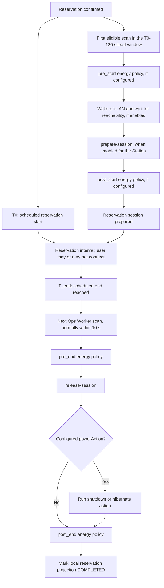
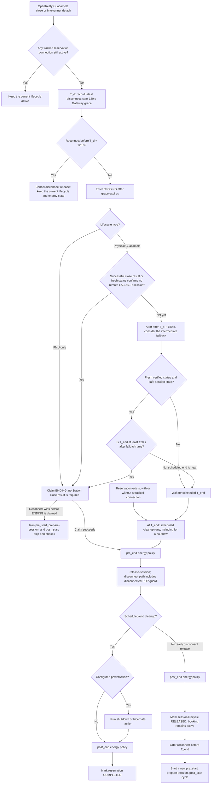
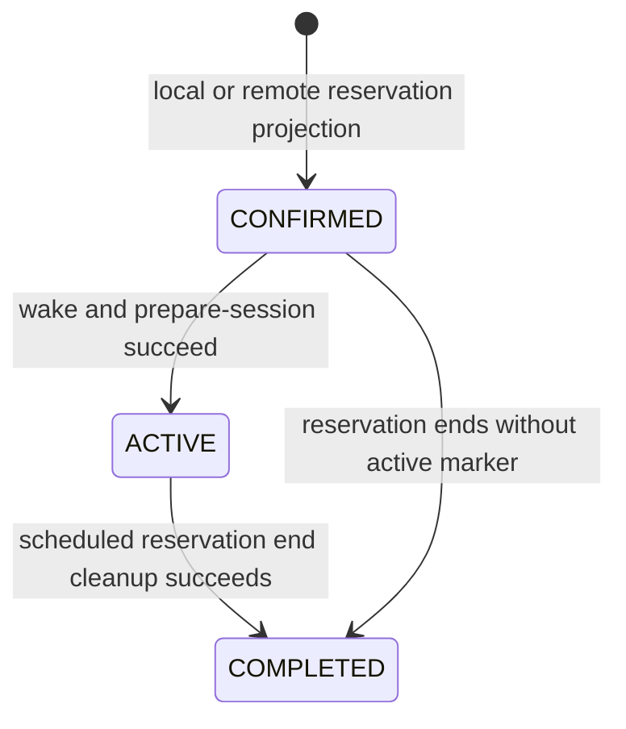

# Lab Gateway and Lab Station Operations

This guide describes the current operational integration between a Lab Gateway and a **Lab Station** that controls a physical laboratory. Windows stations use WinRM and default to Station Contract v3, while legacy v2 Stations remain supported; Linux stations use Station Contract v3 over pinned SSH. The Gateway normalizes the reported contract before persisting telemetry or running reservation operations.

For the network topology around these components, see [Laboratory Connectivity](laboratory-connectivity.md). For the on-chain reservation lifecycle, see [Institutional Reservation Workflow](institutional-reservation-workflow.md).

## Components and responsibility

| Component | Responsibility |
| --- | --- |
| Lab Manager | Gateway UI for host inventory, Guacamole connection selection, operation history, and reservation timeline. |
| OpenResty | Publishes `/lab-manager` and proxies protected `/ops/` requests to the ops worker. |
| Ops worker | Internal Flask service that wraps Wake-on-LAN, WinRM or SSH management, Station telemetry, host inventory, and reservation automation. |
| Lab Station | Windows or Linux CLI/service, telemetry publisher, and controller for the physical lab host. |
| Guacamole / guacd | Browser remote-access plane and protocol proxy for RDP, VNC, or SSH targets. |
| `fmu-runner` | Gateway FMU facade; in station mode it forwards internal requests to the Lab Station FMU executor. |

The Gateway is the management client. Lab Station is never a public web endpoint: it belongs on the lab or management network and accepts only the minimum required management traffic from the gateway.

In Full + N Lite, each Lite runs its own Ops Worker and Station link; the Full
backend remains the reservation/evidence authority. In standalone
`blockchain-services` + N Lite, the standalone backend has no Station link and
each Lite owns the complete local management path.

## Access control

`/lab-manager` and `/ops/` are protected by `LAB_MANAGER_TOKEN` and the configured dashboard/network policy. Use `X-Lab-Manager-Token` or the configured secure Lab Manager cookie for operations; do not place management tokens in operational URLs or host inventory files.

`/ops/health` remains available for service readiness. Every other Ops route is gateway-proxied and subject to the Lab Manager access policy. OpenResty injects the separate `OPS_INTERNAL_AUTH_TOKEN` only after that edge check; the worker rejects direct `/api/*` and `/aas-admin/*` calls without it. The ops worker itself should not be published directly outside the container network.

### Windows stations: WinRM credentials and TLS trust

Both current Windows v3 and legacy Windows v2 Stations use WinRM over HTTPS.
WinRM credentials are deliberately separate from `hosts.json`. A host refers
to a `credential_ref`; the ops worker encrypts the corresponding credentials
using the required `OPS_SECRETS_KEY`.

WinRM certificate trust is also separate from the credentials. The preferred
operator path is to upload the public certificate from the host card's
`WinRM TLS trust` control in Lab Manager. The persistent `ops-data` bind
mount remains the storage boundary for that per-host trust. For a host whose
name is `PC-Siemens`, the resulting directory is:

```text
ops-data/winrm-certificates/pc-siemens/server.cer
```

The directory name is the lower-case `winrm_trust_ref`; when that field is not
present in the host catalog, it defaults to the host name. On startup and
after `POST /ops/api/hosts/reload`, ops-worker creates the directory layout and
inspects the certificate. If the Windows export is DER, the worker also
materializes a `server.pem` copy next to it because Requests/OpenSSL consumes
the PEM form. Every WinRM session then passes that generated PEM as its
per-host `ca_trust_path` while keeping TLS validation enabled. A certificate
is never installed as a global trust override and is never trusted for another
host.

The managed handoff previews the certificate, validates its SAN/CN identity
and validity dates, requires an explicit SHA-256 confirmation, and then uses
the certificate only for that host. The manual bootstrap procedure, which
remains useful for recovery and local deployments, is:

1. Run `LabStation.exe winrm configure` on the Windows station.
2. Copy `C:\ProgramData\DecentraLabs\Lab Station\winrm-server.cer` to the
   matching host directory under `ops-data/winrm-certificates/`.
3. Confirm the certificate thumbprint out of band. For PC-Siemens the current
   SHA-1 thumbprint is `DAD0D2C0835FC00796BB5AFCA4D69A88E7EE0799`.
4. Restart ops-worker or call `POST /ops/api/hosts/reload`.
5. Check `GET /ops/api/hosts` for `winrmTrustStatus=ready` and run a heartbeat.

The certificate file must be the public CER/DER or PEM export only. Do not
copy a private key, use `verify=false`, or use `TrustedHosts` as a substitute
for certificate validation. Lab Manager now manages the same per-host trust
store from the `WinRM TLS trust` indicator on each host card. It previews the
certificate, validates SAN/CN identity and validity dates, requires an explicit
SHA-256 confirmation, and never returns the certificate contents after saving.
When the managed address is an IP literal, the certificate must contain that
address as an `iPAddress` SAN entry; a `dNSName` entry containing the same text
does not satisfy WinRM/OpenSSL hostname verification.

## Host inventory and telemetry

An ops host records the managed address, optional MAC address, optional
directed WoL broadcast, credential reference, and telemetry settings. It does
not contain laboratory IDs; the provider catalog and Guacamole are the source
of the lab-to-host association. New Windows Station entries use contract major
3. Set major 2 for a legacy Station that still uses the v2 contract:

```json
{
  "name": "lab-ws-01",
  "address": "10.192.38.82",
  "mac": "00:11:22:33:44:55",
  "broadcast": "10.192.38.255",
  "credential_ref": "lab-ws-01",
  "contract": { "major": 3 },
  "winrm_transport": "ntlm",
  "winrm_use_ssl": true,
  "winrm_port": 5986,
  "labstation_exe": "C:\\Lab Station\\LabStation.exe",
  "local_mode_flag_path": "C:\\Lab Station\\labstation\\data\\local-mode.flag",
  "heartbeat_path": "C:\\Lab Station\\labstation\\data\\telemetry\\heartbeat.json",
  "events_path": "C:\\Lab Station\\labstation\\data\\telemetry\\session-guard-events.jsonl"
}
```

Windows Stations periodically write `heartbeat.json` and session-event files
at the configured Windows paths. Ops Worker reads them through WinRM and
persists the raw payload alongside its normalized Station model. Linux v3 exposes the
logical `heartbeat` and `session-events` artifacts through the pinned SSH
dispatcher; it does not use Windows paths. Both feeds are available through
the heartbeat and timeline APIs. The normalized model includes
capability-specific readiness (`physicalLab` and `fmu`), active-session state,
local-mode state, recent operations, power state, and Wake-on-LAN diagnostics.
FMU Executor health is relevant to FMU resources, but does not by itself make a
physical lab unavailable.

For Windows discovery, the worker derives the executable, local-mode flag,
heartbeat, and event paths from the installed scheduled task. It keeps legacy
`C:\LabStation` and current `C:\Lab Station` roots compatible; a mixed catalog
is normalized to the root identified by the heartbeat or executable. New Windows
provisioning defaults to `contract.major: 3`; choose major 2 for legacy Stations.
Linux v3 host entries declare `platform: linux`, `contract.major: 3`,
`management.transport: ssh`, and the Station command; their telemetry uses the
logical artifact names above.

The current operational API, exposed through the gateway as `/ops/...`, includes:

| Gateway route | Purpose |
| --- | --- |
| `POST /ops/api/wol` | Send a magic packet; when a managed `host` is supplied, wait for its configured management port and authenticated Station status. |
| `POST /ops/api/winrm` | Run an allowlisted Windows v2 command over WinRM. |
| `POST /ops/api/heartbeat/poll` | Collect and persist the current heartbeat. |
| `GET /ops/api/heartbeat/stream` | Stream heartbeats as server-sent events. |
| `GET /ops/api/hosts` | Read configured and discovered host information. |
| `GET /ops/api/lab-associations` | Read calculated provider-laboratory to registered-host associations used by Lab Manager. |
| `POST /ops/api/hosts/discover` | Probe a Guacamole connection candidate for managed-host signals. |
| `POST /ops/api/hosts/provision` | Create or update a dynamic host after successful discovery. |
| `PATCH /ops/api/hosts/{hostName}` | Update a dynamic host's name, MAC, WoL broadcast, or platform-specific Station settings. |
| `POST /ops/api/hosts/winrm-credentials` | Store encrypted Windows v2 WinRM credentials. |
| `POST /ops/api/hosts/{hostName}/winrm-trust/preview` | Validate and preview a public CER/DER/PEM certificate without persisting it. |
| `GET /ops/api/hosts/{hostName}/winrm-trust` | Read per-host trust metadata and classified status. |
| `PUT /ops/api/hosts/{hostName}/winrm-trust` | Save or replace trust after server-side validation and SHA-256 confirmation. |
| `DELETE /ops/api/hosts/{hostName}/winrm-trust` | Remove the host trust material and return `WINRM_TRUST_REQUIRED` state. |
| `POST /ops/api/station/credentials/{credential_ref}` | Generate an encrypted Ed25519 SSH credential and return its public key for Linux v3 enrollment. |
| `POST /ops/api/station/hosts/{hostName}/trust/preview` | Preview the Linux station SSH host key and fingerprint. |
| `POST /ops/api/station/hosts/{hostName}/trust/confirm` | Pin the SSH host key after the operator confirms its fingerprint out of band. |
| `GET /ops/api/station/hosts/{hostName}/trust` / `DELETE .../trust` | Read or remove the Linux host-key trust entry. |
| `POST /ops/api/station/hosts/{hostName}/verify` | Verify SSH connectivity and the authenticated Station v3 identity. |
| `POST /ops/api/station/command` | Run a neutral allowlisted Station command through the configured transport. |
| `POST /ops/api/hosts/reload` | Reload the static/dynamic host catalog. |
| `POST /ops/api/hosts/local-mode` | Set the station local-mode operational flag. |
| `POST /ops/api/reservations/start` | Start the operational preparation for one reservation. |
| `POST /ops/api/reservations/end` | Finish the operational cleanup for one reservation. |
| `GET /ops/api/reservations/timeline` | Read operations, phases, and latest heartbeat for a reservation. |
| `GET /ops/api/operations/recent` | Read recent operation records for diagnostics. |
| `GET/PUT /ops/api/wake-ops/<host_name>` | Read or configure the per-host weekly Wake Ops verification. |
| `POST /ops/api/wake-ops/<host_name>/wake` | Send a manual Wake and record successful reachability evidence. |
| `GET/PUT /ops/api/shutdown-ops/<host_name>` | Read or update per-host reservation-end and weekly shutdown settings; both automatic settings default to disabled. |
| `POST /ops/api/shutdown-ops/<host_name>/shutdown` | Request an immediate guarded manual shutdown. |

The `/ops/api/winrm` route and `/hosts/*/winrm-*` routes are the Windows v2
compatibility surface. They accept only commands configured in
`OPS_ALLOWED_COMMANDS`. Linux v3 uses `/ops/api/station/*` and the fixed SSH
dispatcher; Gateway verifies Station identity and does not expose an arbitrary
remote shell. Shared status and dispatcher schemas are documented in
`contracts/station/`.

## Reservation preparation and release

The ops worker can be invoked directly by Lab Manager or by its scheduler. The scheduler is controlled by:

```env
OPS_RESERVATION_AUTOMATION=true
OPS_RESERVATION_SCAN_INTERVAL=10
OPS_RESERVATION_START_LEAD=120
OPS_RESERVATION_DISCONNECT_GRACE_SECONDS=120
OPS_RESERVATION_DISCONNECT_CLOSE_FALLBACK_SECONDS=180
```

Reservation end operations become eligible at the scheduled end time and run
on the next orchestrator scan (10 seconds by default); there is no additional
post-end delay.

OpenResty reports reservation-bound Guacamole WebSocket connections, and
`fmu-runner` reports reservation-bound FMU session attachments, to the
authenticated Ops Worker. Manual/admin Guacamole sessions, demos, and local FMU
previews keep their separate lifecycle. When all tracked connections for a
reservation close, the Gateway starts the disconnect grace period. A successful
reconnect within 120 seconds cancels it and preserves the current Station or FMU
session lifecycle without replaying energy phases. For a physical Guacamole
session, Lab Station closes its controlled applications after the same
120-second grace and publishes a reservation-bound result in `status-json`.
If that first Station close attempt fails, both Windows AppControl and the
Linux disconnect watcher make one local retry 25 seconds after the attempt
began, preserving the disconnected desktop for Gateway if cleanup still fails.
The Gateway waits for that result, or a fresh Station status with a successful
session query and no remote LABUSER session, before running `pre_end`,
`release-session`, and `post_end`. If that result is missing, an intermediate
disconnect cleanup cycle can start after 180 seconds total from the latest
disconnect. It requires a Station status no older than 30 seconds and
timestamped after that disconnect, a successful session query, known
remote-client state with no remote client connected, no active local session,
local mode off, and no tracked active reservation connection at the atomic end
claim. It runs `pre_end`, the matching `release-session` with a guard that
refuses to log off a reconnected RDP client, and then `post_end`. Windows
AppControl and Linux Tiny Desk both get an orderly close attempt through that
same release command. A successful early release marks the session lifecycle
`RELEASED` but leaves the reservation active, so a later connection can start a
new session cycle. The reservation is marked complete only at its scheduled
end. A reconnect resets the deadline. If the Station is unavailable, a safety
state is unknown, or active use is detected, disconnect cleanup waits for the
scheduled reservation end, which remains the final fallback. Windows RDP and
Linux XRDP retain a 240-second disconnected-session limit so the Gateway retry
at 180 seconds runs first. FMU-only lifecycles do not need a Station close
result.

Station cleanup does not run energy policies. On Windows, AppControl closes the
managed applications and the later `release-session` logs off the remaining
disconnected RDP session. If the Station close result is missing, `release-session`
initiates the orderly close itself. On Linux, both the disconnect watcher and
`release-session` use the same Tiny Desk close helper, which ends the desktop
after its orderly application-close path. Ops Worker alone sequences the energy
phases, using the lifecycle cycle ID to keep retries and reconnect cycles
separate.

A reconnect after the grace expires is recorded even if the release sequence
is still running. If it arrives after Station has closed the applications and
remains connected before Ops Worker claims `ENDING`, the worker starts a fresh
`pre_start`, `prepare-session`, and `post_start` cycle without starting the end
phases. If a reconnect races an already claimed early release, the Station
guard refuses to log off the active RDP client; disconnect cleanup remains
pending until the session disconnects again or the scheduled end performs final
cleanup. The Prepare request and energy steps use distinct cycle identities so
the Station can create a new lease generation and the power policy can execute
again. The scheduled end still handles the final boundary and no-show
reservations that never create a tracked connection.

### Reservation timing and energy phases

`T0` is the reservation start and `T_end` is its scheduled end. With the
default 120-second start lead and 10-second scheduler scan, preparation
normally starts on the first scan in the `T0-120 s` to `T0-110 s` window.
`pre_start` runs before Wake-on-LAN; `post_start` runs after session
preparation. The reservation workflow does not dispatch a separate `start`
energy phase. At `T_end`, cleanup is eligible immediately and starts on the
next scan, normally within 10 seconds. The diagram shows the successful path;
failed operations are recorded and reconciled by the orchestrator.



### Lab Station disconnect detection and close retry

`T_s` is the time each Station detects the RDP/XRDP disconnect. It is measured
locally and is independent of the Gateway's `T_d` timestamp below. On either
platform, reconnecting within the local 120-second grace retains the existing
workspace. After the grace, each Station makes an orderly close attempt and,
if that attempt fails, exactly one retry. The retry is scheduled 25 seconds
after the first attempt begins; if the first attempt is still running at that
deadline, the retry runs as soon as the first attempt returns. A reconnect
while the retry is pending cancels that retry.

```mermaid
flowchart TD
    subgraph WINDOWS["Windows Lab Station"]
        W_DETECT["T_s: WTS reports RDP disconnect"] --> W_GRACE["Keep the RDP desktop and apps for 120 s"]
        W_GRACE -->|"Reconnect before 120 s"| W_KEEP["Cancel grace; retain the existing workspace"]
        W_GRACE -->|"Grace expires"| W_CLOSE["AppControl orderly-closes managed apps and logs off the disconnected desktop"]
        W_CLOSE -->|"Close, logoff, and result report succeed"| W_DONE["Publish successful reservation close result"]
        W_CLOSE -->|"Any close, logoff, or report step fails"| W_RETRY["Schedule the single retry for first-attempt start + 25 s"]
        W_RETRY -->|"Reconnect before retry"| W_CANCEL["Cancel the pending retry"]
        W_RETRY -->|"Still disconnected"| W_CLOSE2["Retry orderly app close and desktop logoff once"]
        W_CLOSE2 -->|"Success"| W_DONE
        W_CLOSE2 -->|"Failure"| W_WAIT["Keep the disconnected desktop for Gateway release-session"]
        W_WAIT -. "Independent OS safety limit" .-> W_LIMIT["RDP disconnected-session limit: 240 s after OS disconnect"]
    end

    subgraph LINUX["Linux Lab Station"]
        L_DETECT["T_s: agent detects XRDP client disconnect; polls every 1 s"] --> L_GRACE["Keep Tiny Desk and XRDP session for 120 s"]
        L_GRACE -->|"Reconnect before 120 s"| L_KEEP["Cancel disconnect watch; retain the existing workspace"]
        L_GRACE -->|"Grace expires"| L_CLOSE["Orderly-close Tiny Desk apps and end the XRDP session"]
        L_CLOSE -->|"Close confirmed"| L_DONE["Publish successful reservation close result"]
        L_CLOSE -->|"Close fails or Tiny Desk remains"| L_RETRY["Schedule the single retry for first-attempt start + 25 s"]
        L_RETRY -->|"Reconnect before retry"| L_CANCEL["Clear the disconnect watch and cancel the retry"]
        L_RETRY -->|"Still disconnected"| L_CLOSE2["Retry orderly Tiny Desk close once"]
        L_CLOSE2 -->|"Success"| L_DONE
        L_CLOSE2 -->|"Failure"| L_WAIT["Keep the disconnected XRDP session for Gateway release-session"]
        L_WAIT -. "Independent OS safety limit" .-> L_LIMIT["XRDP disconnected-session limit: 240 s after OS disconnect"]
    end
```



When local cleanup succeeds, Lab Station publishes the result; it does not
run the Gateway's energy phases. When both local attempts fail, the desktop is
left available for the Gateway's orderly `release-session` retry. The 240-second
RDP/XRDP limit is an independent operating-system safety net, not an energy
phase or the normal close path.

### Gateway disconnect release and reservation end

`T_d` is the latest disconnect reported for all tracked connections belonging
to the reservation. OpenResty reports Guacamole connections and `fmu-runner`
reports FMU attachments. A later disconnect resets the Gateway deadline. The
Gateway scans every 10 seconds by default. A physical Station has a close-result
gate; an FMU-only lifecycle does not. The 180-second physical fallback is
measured from `T_d` and is allowed only if the scheduled end is at least
120 seconds later, leaving the scheduled end to own cleanup near the boundary.



For fallback eligibility, the physical Station status must be no older than 30
seconds, timestamped after `T_d`, and report a successful session query, known
disconnected remote-client state, no active local session, and local mode off.
The atomic claim also rejects a newer tracked connection; fallback additionally
requires no active tracked connection. If reconnect arrives after the 120-second
grace but before the claim, it can win the race and start a new session cycle
without running `pre_end` or `post_end`. If it arrives after `ENDING` is
claimed, the Station's disconnected-RDP guard prevents logoff of a connected
client; cleanup remains pending until another disconnect or `T_end`. An early
disconnect release runs the energy end phases but leaves the reservation active
until its scheduled end. Only scheduled-end cleanup marks it `COMPLETED`.

In Full mode it consumes the local `lab_reservations` projection, not the
contract directly. In Lite mode it polls the authenticated
`/reservations/projection` feed from the remote reservation backend. That feed
is scoped to the Lite gateway's registered `accessURI`; the Lite keeps only
its durable `reservation_operations` journal, so it does not need a local
copy of the provider's reservation table. Consequently, these local states
are operational only:

When the Lite scheduler dispatches Prepare or Release, it carries the matching
reservation row from that authenticated projection into lease construction.
This avoids a second lookup in the absent local `lab_reservations` table. The
local `reservation_operations` journal remains the source for idempotency and
for the successful Prepare generation required by Release. Full-mode manual
lifecycle calls without a scheduler snapshot continue to resolve reservation
data from the Gateway's local projection.



During an active reservation, disconnect cleanup can release the current
session lifecycle while the booking remains `ACTIVE`. A later reconnect starts
a new session cycle; only cleanup at the scheduled end changes the booking to
`COMPLETED`.

These local labels must not be confused with the on-chain states `CONFIRMED`, `ACCESS_AUTHORIZED`, `SETTLED`, or `CANCELLED`.

The start path is normally:

1. Resolve `labId` from the provider catalog, then follow its `accessKey` to the current Guacamole connection and unique registered host.
2. Send Wake-on-LAN when requested and wait for reachability.
3. Run `prepare-session` for a `dedicated` or `hybrid` physical Station. It
   refuses `fmu-only` or an unavailable session inventory. If a remote LABUSER
   session exists, Gateway checks the authoritative reservation projection for
   every lab mapped to the Station. An administrative Prepare is blocked by any
   active/imminent mapped-lab reservation or unknown reservation state. For a
   reservation-bound Prepare, the incoming reservation may be the only
   reservation that is active or imminent; another active/imminent reservation,
   unknown state, or access-session evidence for the incoming reservation blocks
   the handoff. Otherwise,
   it passes the exact observed session IDs to the Station's normal
   profile-specific handoff. Hybrid also refuses active or unknown local mode and
   uses its configured confirmation policy: when eviction is enabled, each
   eligible local session must confirm a graphical prompt before eviction. The
   grace deadline starts with the first prompt, so time spent confirming counts
   against it and any remaining time allows voluntary sign-out. A decline,
   timeout, suppressed or unavailable prompt fails Hybrid Prepare before it
   closes a local session that remains active. Dedicated cannot enable local
   mode; it warns every local session, waits the configured grace period, then
   logs off every remaining local session without an accept/decline prompt.
   If any warning cannot be sent, Prepare fails before logoff. This applies to
   LABUSER and other local accounts on both Windows and Linux.
   Prepare also clears bounded user working data and FMU temporary state before
   opening the reservation. Remote sessions under accounts other than managed
   `LABUSER`/`labuser` are not currently included in the handoff; shared FMU
   Executor cleanup may affect their work. See the [session policy
   matrix](lab-station-session-policy-matrix.md).
4. Record every attempt in `reservation_operations` and move the local projection to `ACTIVE` only after success.

The end path normally runs the reservation's matching `release-session` without rebooting and can request a shutdown or hibernation action. On a Dedicated station, matching reservation Release logs off active local non-LABUSER console sessions and the managed remote LABUSER session (RemoteApp/RDP on Windows; XRDP/Tiny Desk on Linux), then restarts an installed FMU Executor and clears its temporary state. Administrative Release logs off the local non-LABUSER console sessions when allowed by the existing Station lease and remote-session protections. A local LABUSER console session remains signed in. Hybrid Release preserves local console sessions. Administrative Release is rejected while a Station lease or any remote LABUSER session is active; without a lease the Station cannot prove whether that remote session is reserved, so it remains protected. Incomplete session or FMU cleanup fails Release, leaves a reservation lease `recovery-required`, and prevents a requested reboot. A reboot is reserved for an explicit operational request, not the normal end-of-reservation path. The worker records the result and moves the local projection to `COMPLETED` only after successful cleanup. Missing host mappings and failed operations are recorded; they must be investigated rather than inferred from an on-chain reservation status.

Each Station checks the lease's `expiresAt` locally as a fail-safe. Linux
checks from `labstationd`; Windows checks from the setup-managed
`LabStation\BackgroundService` task on each service-loop iteration (normally
every five seconds). Both platforms persist expiry Release attempts in the
lease journal. A `recovery-required` lease remains closed to new work, and the
Station issues a fresh lease-bound Release attempt every 60 seconds until
cleanup succeeds. Recovery can begin after lease expiry, or sooner when a
lease-bound Release itself failed into `recovery-required`; a failed Prepare
does not trigger Release while its reservation is still active. The agent never
reuses an uncertain operation ID. Before each attempt it requires a valid
lease identity, local mode off, and a known session inventory. Hybrid defers
while any local user session is active; both profiles defer for remote
non-LABUSER sessions. Dedicated Release closes active local non-LABUSER console
sessions and the managed remote LABUSER session. A local LABUSER session may
remain signed in. Unknown or corrupted lease identity remains blocked for
operator repair.

Dispatcher v2 uses the same durable operation-status protocol over SSH and
WinRM. Gateway queries `operation.status` before dispatch, retains the original
operation ID on retries, and queries again after an uncertain transport
result within one dispatch. For a scheduled reservation end whose Release
failed, the orchestrator waits `OPS_RESERVATION_RETRY_COOLDOWN`, sends a new
lease-bound Release ID, skips already completed `pre_end` steps, and then runs
`post_end` after Release succeeds. The reconciliation Release carries the
same local-session guard as the Station watchdog, including a second session
check before FMU cleanup. This lets the Gateway confirm completion after either
Station's local reconciler has recovered the lease, while each Station still
protects its own session state when Gateway connectivity is unavailable.

Lab Manager's operator `Prepare`/`Release` controls follow the same physical
profile rules and carry no reservation context. The Station rejects them while
an active Station lease or pending recovery is persisted. Dedicated `Release`
closes active local non-LABUSER console sessions; local LABUSER remains signed
in. Hybrid `Release` preserves the local console user. Administrative `Release`
is also blocked by any remote LABUSER session. Administrative `Prepare` may
handoff a remote LABUSER session only after Gateway proves that no mapped-lab
reservation is active or imminent. `Enable Local` is hybrid-only. The current
v3 path requires a fresh session inventory, no remote LABUSER session, and no
active persisted Station lease, but does not query Gateway's authoritative
reservation projection; use it outside active reservation windows. The legacy
Windows v2 compatibility route updates the marker file directly and does not
apply the Station-side lease check. Clearing an already active flag remains
possible for cleanup.
Before manual `Prepare`, the Gateway requires a fresh session inventory and
authoritative proof that a remote `LABUSER` session has no active/imminent
reservation on any mapped lab. If reservation state is unknown or a mapped-lab
reservation is active, it refuses before sending Prepare. When the session is
proven unreserved, it passes the exact session IDs to the Station, which applies
the profile's handoff and rechecks the inventory before cleanup. The response
explains that Prepare clears LABUSER temporary files, Downloads, and lab scratch
data and may interrupt open apps. Reservation-bound Prepare may proceed when its
own reservation is the only active/imminent reservation and has no existing
access-session evidence; another active reservation or unknown state blocks it.

## Wake Ops

Wake Ops is enabled by default for configured hosts and runs once a week on
Sunday at 08:00 in the Gateway's `TZ` timezone. Lab Manager exposes the same
schedule under **Operations → Wake Ops**, including the manual **Wake** action.
The weekly cycle classifies both Windows v2 and Linux v3 through the configured
management port and an authenticated Station status over that transport. A
closed management port is treated as off only when heartbeat evidence is not
recent and does not report local mode enabled. An open port whose Station
identity cannot be verified is ambiguous, so no power command is sent. Before
cycling an online Windows or Linux Station, Wake Ops requires a fresh status
with local mode disabled and a successful
session inventory containing no active user sessions. The Gateway applies this
same preflight to every managed `power shutdown`, then both Station agents
check the same conditions before powering off and cancel if the state changed.
When a command requests a nonzero delay, the Station checks again when it ends.
Managed Shutdown also audits Wake-on-LAN readiness without repairing settings;
regular Shutdown proceeds with a warning on either platform when readiness is
incomplete. Wake Ops requires persistent Wake-on-LAN readiness and stops if it
is incomplete. Wake Ops manual and scheduled requests send the same WoL packet,
wait on the configured management port, and verify the authenticated Station
identity before recording success. An online station is
shut down before WoL; a verified-off station is woken and shut down again; an
ambiguous state does not receive a remote shutdown. Configure the weekly window
outside reservations and planned local use. Successful WoL evidence remains
valid for seven days and is stored in `reservation_operations`.

## Shutdown Ops

Open **Operations → Lab Station Ops → Shutdown Ops** for a station. The modal
can send a manual shutdown, enable shutdown after each reservation, or enable a
weekly shutdown at a chosen day, local time, and timezone. Reservation-end and
weekly automation are disabled until explicitly enabled. Manual, reservation-end,
and weekly Shutdown Ops commands are sent without an extra countdown after the
Gateway confirms the Station is idle. Lab Station checks local mode and active
sessions again immediately before powering off and cancels if either check
detects use.
Saving or changing a weekly schedule does not trigger an immediate shutdown; it
takes effect at the next selected weekly time.

Reservation-end shutdown runs after the reservation's `release-session` and
before the lab's `post_end` energy phase. It is best-effort: a blocked or failed
station shutdown is recorded, while reservation cleanup and the remaining
energy phase continue. It requires `OPS_RESERVATION_AUTOMATION=true`.
Weekly shutdown skips stations that are off or
unreachable; ambiguous status and unsafe session state are recorded as blocked
without sending a power command. The schedule is stored in the local Ops
database and applies to stations in both Full and Lite deployments.

## Windows v2 CLI and Linux v3 dispatcher

The following CLI examples describe Windows v2 at the host's configured
`labstation_exe` path (normally `C:\Lab Station\LabStation.exe`). Linux v3
uses the configured `station.command` (normally `/usr/bin/labstationctl`) over
the pinned SSH connection and the structured dispatcher contract in
`contracts/station/dispatcher/v2/`. Do not substitute arbitrary shell commands
for the dispatcher request.

| Command | Use in the gateway lifecycle |
| --- | --- |
| `prepare-session` | Dedicated warns and automatically hands off every eligible local session after the grace period; Hybrid uses local mode and its confirmation policy. For a remote LABUSER session, administrative Prepare requires no active/imminent mapped-lab reservation. Reservation-bound Prepare may hand off a residual session when its incoming reservation is the only active/imminent mapped-lab reservation and has no prior access-session evidence; another reservation or unknown state protects the session. |
| `release-session` | A matching reservation context ends that lease's remote lab-user session, terminates installed FMU Executor sessions and clears temporary state. Administrative Release is blocked while a remote LABUSER session exists; an explicit matching request can include a controlled reboot after cleanup succeeds. |
| `status-json <path>` | Writes a fresh status report for inspection or heartbeat collection. |
| `power shutdown` / `power hibernate` | Performs a controlled power action. Every Gateway-managed shutdown, on Windows or Linux, requires the Station to advertise the idle-guard capability, local mode to be off, and a complete session inventory with no active user sessions. The Gateway checks before dispatch and the Station checks again after the optional delay. |
| `recovery reboot-if-needed` | Performs a safeguard reboot only when station diagnostics justify it, unless explicitly forced. |
| `service ...` | Manages the Lab Station scheduled background task when required. |

An agent that does not advertise `power-idle-guard-v1` cannot receive a
Gateway-managed shutdown. Update that Station agent to enable the shared guard.

For both platforms, exit code `0` means success, `1` means completed with a
warning, and values of `2` or greater indicate failure. The station records
actions in its platform logs, heartbeat, and operation-specific telemetry.

## Connectivity requirements

- **Wake-on-LAN:** on Linux, activate `docker-compose.wol.yml` so `ops-worker` and `guacd` have static macvlan endpoints on the Station VLAN. Exclude `WOL_LAN_IP_RANGE` from the dynamic pool on the actual DHCP server, whether that is the router or `dnsmasq` on the Gateway host; the Compose overlay and `setup.sh` do not edit DHCP configuration. Check leases before changing an existing pool. Configure distinct fixed `WOL_LAN_OPS_WORKER_IPV4` and `WOL_LAN_GUACD_IPV4` values so Station WinRM and RDP firewall scopes do not drift when containers are recreated. Leave `WOL_LAN_GATEWAY` empty for an isolated VLAN, or set the actual VLAN router when targets exist outside the configured subnet. Persist the directed broadcast (for example `10.192.38.255`) in the host entry and as Guacamole's `wol-broadcast-addr`, alongside `wol-send-packet=true` and `wol-mac-addr`. The target Station's firmware and network interface must support and be configured for magic-packet wake.
- **Station management:** Windows v2 hosts use WinRM HTTPS on 5986; Linux v3 hosts use SSH on their configured port (22 by default), Ed25519 service credentials, a pinned host key, and the forced Station dispatcher. Set `STATION_MANAGEMENT_CIDRS` to the destination CIDR(s) containing the Station addresses managed by this Gateway. This may differ from the Gateway's source or macvlan subnet; list multiple Station networks as comma-separated CIDRs. `WINRM_MANAGEMENT_CIDRS` remains a compatibility alias.
- **Guacamole:** `guacd` can reach the station's configured RDP, VNC, or SSH service over the lab network.
- **FMU station mode:** when `FMU_BACKEND_MODE=station`, `fmu-runner` can reach `FMU_STATION_BASE_URL` and authenticate with `FMU_STATION_INTERNAL_TOKEN`.
- **Telemetry:** Ops Worker reads logical `heartbeat` and `session-events` artifacts through the selected Station transport. Windows v2 path reads remain inside the compatibility adapter.

Linux host rows declare `platform: linux`, `contract.major: 3`, and
`management.transport: ssh`. Generate a per-host key from Lab Manager, install
the public key with `labstationctl setup --management-public-key`, preview and
confirm the SSH host-key fingerprint, then verify the authenticated Station v3
identity. An open port alone remains `trust-pending` and is not a ready Station.

The canonical Station v3 schemas and Windows/Linux fixtures live in
`contracts/station/`. Gateway normalizes v2 and v3 before persistence,
readiness, AAS, and timeline projection. In v3 command results, exit code 1 is
a completed warning; only exit code 2 or higher fails a reservation step.

No station management service, WinRM or SSH listener, RDP endpoint, or FMU
executor should be reachable from the public Internet.

## Failure handling and observability

The ops worker persists heartbeat and reservation operation records, and retries notification delivery for configured operational failures. Check these sources together when investigating an incident:

- `reservation_operations` for wake, prepare, release, and scheduler outcomes;
- `lab_host_heartbeat` for the last station state and raw telemetry;
- Lab Station logs and telemetry on the affected Windows or Linux host;
- ops-worker logs for WoL, WinRM/SSH, database, or notification errors.

The reservation timeline endpoint provides the combined operational view. It is the correct first diagnostic surface; it does not prove an on-chain access authorization or settlement state.

## Related implementation surfaces

- Detailed profile, session and Prepare/Release matrix: [Lab Station session policy matrix](lab-station-session-policy-matrix.md)
- Gateway proxy and protection: `openresty/gateway.conf`
- Ops worker: `ops-worker/worker.py`
- Host configuration: `ops-worker/hosts.example.json`
- Lab Station CLI and service: `Lab Station/labstation/`
- Linux Station core and packaging: `Lab Station Linux/`
- Shared FMU Executor source: `FMU-Executor/`
- Windows v2 WinRM command details: `Lab Station/docs/winrm-command-contract.md`
- Shared Station status and dispatcher contracts: `contracts/station/README.md`
