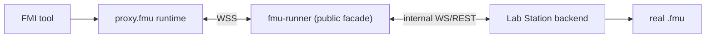

# FMU Runner

Gateway-side FMU facade for DecentraLabs.
Runs as a Docker container inside the Lab Gateway stack, protected by OpenResty JWT validation.

It exposes the public REST/WSS contract consumed by generated `proxy.fmu` artifacts.

Deployment contract:

- production `.fmu` files live on Lab Station
- this service remains in the Gateway as the public FMU facade
- execution and model loading move behind an internal `station` backend

Backend strategy:

- production and local Compose profiles both delegate FMU execution to the
  shared FMU Executor; production targets Lab Station and development uses a
  local container
- the `fmu-runner-local` development profile keeps the Gateway facade and
  delegates execution to a local FMU Executor container pulled from the shared
  versioned FMU-Executor image
- the local `fmu-data` directory is shared with that Executor; Gateway keeps a
  read-only mount for AAS metadata and proxy generation
- `station` is the production target when real FMUs must remain on Lab Station
- Batch simulations run in a fresh Executor worker process; realtime sessions
  remain stateful in the Executor and Gateway proxies the WebSocket channel.



For Full + N Lite, the public facade and Station executor are local to the
selected Lite while the Full backend supplies the ticket and observation
authority. For standalone `blockchain-services` + N Lite, the same facade is
local to each Lite and the standalone backend is remote. The public contract
does not change between these topologies.

## Endpoints

| Method | Path | Description |
|--------|------|-------------|
| GET | `/health[?labId=<labId>]` | Liveness and executor-capacity probe; `labId` adds per-lab capacity for public status |
| GET | `/api/v1/fmu/list` | Return authorised FMU through the active backend |
| GET | `/api/v1/fmu/proxy/{labId}?reservationKey=...` | Auto-generate reservation-scoped `proxy.fmu` |
| GET | `/api/v1/simulations/describe?fmuFileName=<file>` | Read FMU model description through the active backend |
| POST | `/api/v1/simulations/run` | Execute a simulation through the active backend |
| POST | `/api/v1/simulations/jobs` | Submit one reservation-scoped, cancellable simulation |
| POST | `/api/v1/simulations/batches` | Submit up to 8 parameter scenarios against the same FMU |
| GET | `/api/v1/simulations/{id}` | Read job state, elapsed time, and batch progress |
| POST | `/api/v1/simulations/{id}/cancel` | Cancel a running job or remaining batch cases |
| GET | `/api/v1/simulations/{id}/result` | Read a terminal result, including available partial output |
| GET | `/api/v1/simulations/history?limit=20&offset=0` | Page through history for the authorized reservation |
| POST | `/api/v1/simulations/stream` | Stream simulation output through the active backend |
| WS | `/api/v1/fmu/sessions` | Realtime FMU session facade with reservation-bound authorization |

The model-description response is defined by the
[FMU Executor](https://github.com/DecentraLabsCom/FMU-Executor/blob/main/README.md#runtime-capabilities).
The Gateway applies its AAS-based variable-access policy separately; see
[AAS support](../docs/aas-support.md#fmi-variable-access-policy).

When the AAS admin integration is enabled, the Lab Manager exposes a unified
AAS association catalog. BaSyx is the source of truth for generated and
imported shells; the lightweight catalog under `AAS_CATALOG_PATH` (default
`/app/data/aasx`) retains only imported-package provenance. Link files retain
only external-shell mappings. The Gateway does not retain uploaded archives;
downloads are generated from the current BaSyx resources.

AASX uploads are limited to 50 MiB compressed, 256 MiB total expanded content,
10,000 ZIP entries, and 16 MiB for the environment part (1 MiB for each OPC
relationships part). DTD and entity declarations are rejected. The Gateway
rejects oversized input before synchronizing any resources.
The Lab Manager uses these protected endpoints to manage the associations:

| Method | Path | Description |
|--------|------|-------------|
| GET | `/aas-admin/aas/catalog` | List generated, imported and linked AAS associations |
| GET | `/aas-admin/aas/{labId}/view` | Read the association metadata and resource IDs |
| GET | `/aas-admin/aas/{labId}/download` | Generate an AASX from the current BaSyx resources |
| DELETE | `/aas-admin/aas/{labId}` | Delete generated/imported BaSyx resources or unlink an external shell |

Deletion is idempotent for resources already absent from BaSyx. If BaSyx is
unavailable or a resource cannot be deleted, the local association remains in
the catalog so the operation can be retried. Downloads reflect the current
BaSyx state and are not byte-for-byte copies of the uploaded archive.
Legacy `.aasx` files from versions that retained archives are ignored by the
new download path and are removed when their catalog association is deleted.

The internal Runner WebSocket requires the non-empty `FMU_INTERNAL_WS_TOKEN`
through `X-Internal-Session-Token`. If it is absent, the endpoint rejects every
connection (fail-closed). The Station endpoint applies the same rule to
`FMU_INTERNAL_TOKEN`; keep both services private even when the tokens are set.

The Gateway forwards reservation-scoped jobs and results to the Executor; the
Executor owns execution quotas, runtime limits, retention and result evidence.
See the [FMU Executor README](https://github.com/DecentraLabsCom/FMU-Executor/blob/main/README.md)
for those limits. Gateway-side request bounds and Compose values are documented
in the [configuration reference](../docs/reference/configuration.md); effective
limits are constrained by both services.

## Backend Modes

| Mode | Purpose | Real FMU location | Notes |
|------|---------|-------------------|-------|
| `local` | Development profile | Local FMU Executor container | Gateway delegates through the same internal HTTP/WSS contract as Station mode |
| `station` | Target production mode | Lab Station | Gateway becomes auth + proxy + router only |

## Unit Tests

Tests use **pytest** + **FastAPI TestClient** (httpx). They cover the public
facade, AAS metadata, authorization, and forwarding to the remote FMU Executor
over its internal REST/WSS contract. Gateway tests do not run FMUs in-process.
The Compose development profile uses the shared FMU Executor image so local
runs follow the same execution path as production.

### Prerequisites

```bash
cd fmu-runner
pip install -r requirements.txt pytest numpy
```

### Run

```bash
pytest
pytest -v
```

## Docker

Built and started automatically by `docker-compose.yml` in the Lab Gateway root.

```bash
# From Lab Gateway root: production Station facade
docker compose --profile fmu-runner up --build fmu-runner

# Development-only facade plus shared local FMU Executor
FMU_RUNNER_ENABLED=true docker compose --profile fmu-local-dev up --build fmu-runner-local
```

The local profile pulls `ghcr.io/decentralabscom/fmu-executor:0.2.1` by default.
Set `FMU_EXECUTOR_IMAGE` in `.env` to select another released image tag. No
FMU-Executor source checkout is required. Station mode and the local profile
require FMU Executor 0.2.1 or newer for the asynchronous job, batch, status,
cancellation, result, and history APIs.
When the backend is a Lab Station, retrieving a companion GLB also requires
FMU Executor 0.3.0 or newer for the authenticated scene endpoint.

FMU files are mounted read-only in both containers. The local Executor uses a
private executable tmpfs for extraction. See
[fmu-data/README.md](../fmu-data/README.md) for local fixtures and sync behavior;
the Executor README owns the FMU storage layout and access-key mapping.

That mount belongs to the `fmu-runner-local` development profile. It is not
part of the intended production execution topology.

Target production topology:

- the real FMU lives on Lab Station
- the Gateway keeps the public REST/WSS contract
- the Gateway forwards describe/list/run/stream/session operations to an internal Station backend
- internal Station requests use `X-Internal-Session-Token`; realtime `session.create` and `session.attach` carry validated `gatewayContext`

Marketplace upload is disabled by design.

## Gateway-specific session controls

The Gateway owns public JWT and ticket authorization, session observation,
rate limits, and proxy artifact integrity headers. Their user-facing contract
is described in [FMI/FMU support](../docs/fmi-fmu-support.md). The internal
message protocol, execution limits and Station API are owned by the
[FMU Executor](https://github.com/DecentraLabsCom/FMU-Executor/blob/main/README.md).
